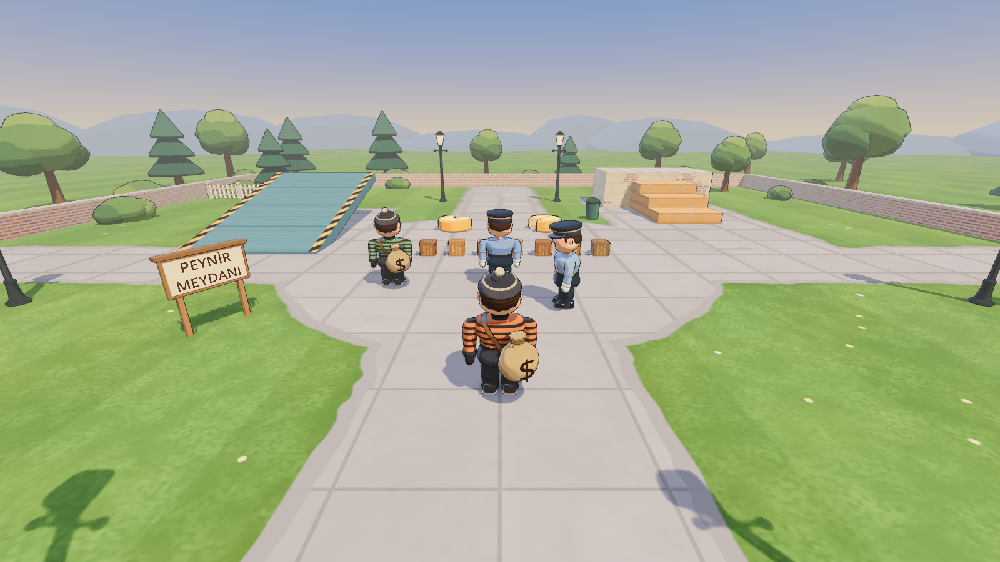
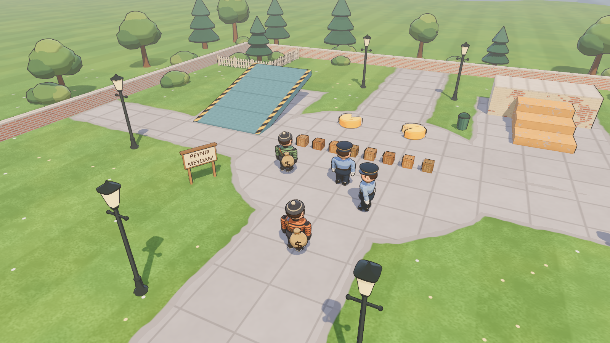
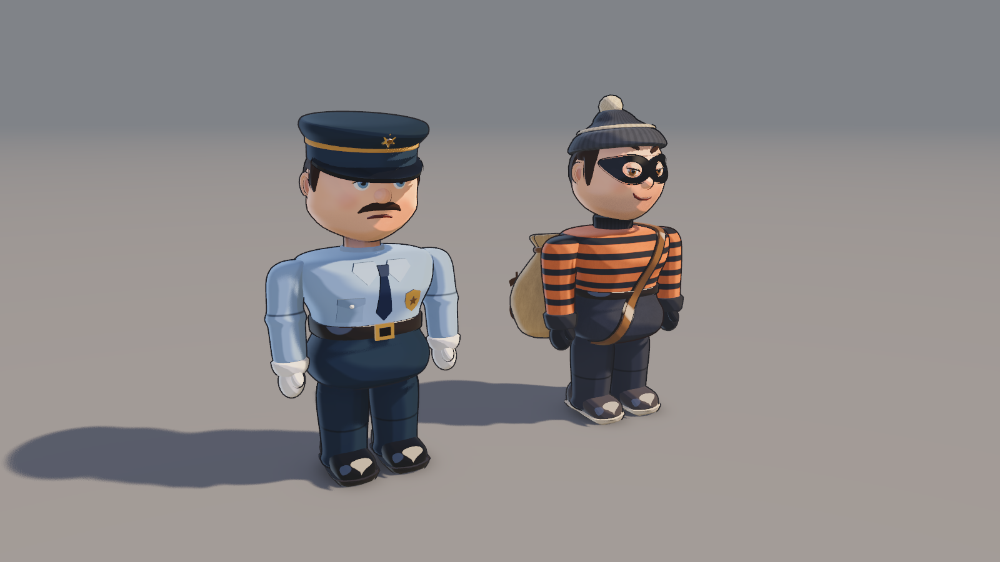

# Kaçık Soygun ("Crazy Heist")

> 🚧 **Status: in progress.** Early development. This is a showcase page; the source code is private.

A **Godot 4** physics party game: a gang of wobbly ragdoll toy-figure thieves tries to pull off
chaotic heists while the cops try to stop them.

## Gameplay

- **Thieves vs. cops:** thieves grab loot, fill their sacks and escape; cops chase, trap and catch them.
- **Physics ragdolls:** characters stumble, fall, get launched and get back up. Grab with both hands, carry and throw objects (and each other).
- **Class abilities:** banana throw, grappling hook, net gun, magnet, balloon, bowling ball, disguise, impersonation, police dog and more, each with its own tuning.
- **Round events:** an event director triggers chaotic mid-round events (designed so viewers can vote on them during streams later).
- **Controls:** keyboard + mouse or gamepad.

| | |
|---|---|
|  |  |

## Tech

- **Godot 4.7** (GDScript), 3D physics-based character controller with active ragdolls
- **Automated tests** with GUT (Godot Unit Test), run headless from the command line
- Data-driven ability/class tuning (Godot resources)
- Sound effects: CC0 Kenney packs layered with procedurally synthesised sounds (Python + NumPy)
- Turkish and English localisation

## Roadmap

- [x] Playable arena with thieves, cops and abilities
- [x] Round flow, loot and event director
- [ ] More maps and heist objectives
- [ ] Online multiplayer
- [ ] Streamer features (chat-voted events)

---
© 2026 Özgür Değirmenci. All rights reserved.
